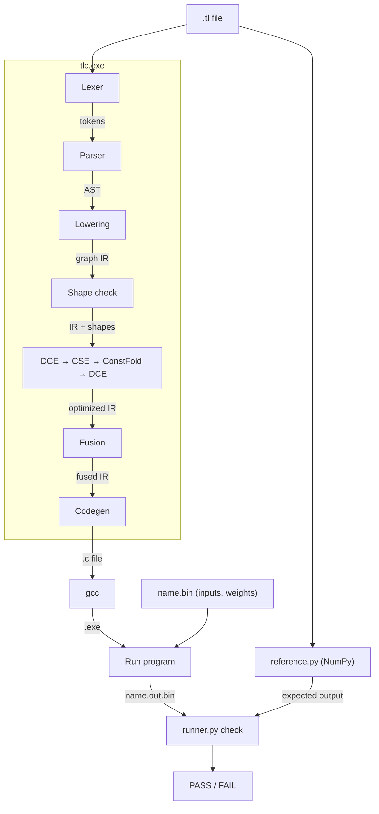

# TensorLite: a mini ML graph compiler

TensorLite is a small compiler, written in C++17, for a tiny neural-network language
(`.tl` files). It lexes and parses the source into an AST, lowers it to a graph IR (a DAG
of tensor operations), infers and checks shapes, and optimizes the graph with dead code
elimination, common subexpression elimination and constant folding. It then fuses
`matmul → add → relu` chains into one kernel and emits plain C, either with naive loops
or with cache-tiled and unrolled loops. The generated C is compiled with `gcc`, timed, and
checked against an independent NumPy implementation. Everything runs natively on Windows.

## Results at a glance

- **17.4× faster than naive at `-O3` on `bench_large.tl`** (1796 → 103 ms) with tiling
  (config `fused+tile64`; see section 5 for why: cache locality and SIMD together).
- **4 of 5 intermediate buffers eliminated** by fusion.
- **106 tests pass:** 10 error tests, plus 96 correctness runs (6 examples × 16 flag
  combinations), each checked against NumPy.

---

## 1. Architecture

```
.tl file
  → Lexer          (tokens)
  → Parser         (AST)
  → Lowering       (graph IR)
  → Shape check    (shapes on every node, errors)
  → Passes         (DCE → CSE → constant folding → DCE)
  → Fusion         (matmul+add+relu → one node)
  → Codegen        (.c file)
  → gcc            (.exe)
  → bench.py       (timing + NumPy check)
```

### Data flow


| Stage | Source |
|---|---|
| Lexer | `src\lexer.cpp`, `src\token.h` |
| Parser, AST | `src\parser.cpp`, `src\ast.h`, `src\ast_dump.cpp` |
| Graph IR, topological sort | `src\ir.h`, `src\ir.cpp` |
| Lowering | `src\lower.cpp` |
| Shape inference | `src\shape.cpp` |
| Passes | `src\dce.cpp`, `src\cse.cpp`, `src\constfold.cpp` |
| Fusion | `src\fusion.cpp` |
| C code generation | `src\codegen.cpp` |
| Driver (CLI) | `src\main.cpp` |
| NumPy reference, tests, benchmark | `bench\reference.py`, `bench\runner.py`, `tests\run_tests.py`, `bench\bench.py` |

---

## 2. The language

### Example (`examples\mlp.tl`)
```
input  x[64,128]
weight w1[128,256]
weight b1[256]
weight w2[256,10]
h = relu(add(matmul(x, w1), b1))
y = matmul(h, w2)
output y
```

### Grammar (recursive descent, one parser function per rule)
```
program  := stmt* EOF
stmt     := decl | assign | output
decl     := ('input' | 'weight') IDENT '[' dims ']'
          | 'const' IDENT '[' dims ']' '=' NUMBER
dims     := NUMBER (',' NUMBER)?
assign   := IDENT '=' expr
expr     := IDENT
          | IDENT '(' expr (',' expr)* ')'
output   := 'output' IDENT
```

- Tensors are 1D or 2D, `float32`, row-major.
- `const c[N] = 0.5` is a tensor filled with one value.
- `#` starts a comment.
- Ops:

| Op | Inputs | Result |
|---|---|---|
| `matmul(A, B)` | `A[M,K]`, `B[K,N]` | `[M,N]` |
| `add(A, B)` | same shape, or `A[M,N]` with `B[N]` (B repeated for every row) | shape of A |
| `mul(A, B)` | same as `add`, elementwise | shape of A |
| `relu(A)` | any | shape of A |

Errors are reported as `error: <file>:<line>:<col>: <message>` and exit with code 1. For example:
```
error: tests\errors\matmul_mismatch.tl:4:5: matmul inner dims mismatch: [64,128] x [256,10]
```

---

## 3. The optimizations, shown with `--dump-ir`

`.\tlc.exe <file.tl> --dump-ir` prints the IR after lowering and after every pass. `%N` is
a node id. Ids are never reused, so gaps appear after nodes are removed.

### Dead code elimination (`examples\dead_code.tl`)
`unused` is never used by an output, so it is removed, and so is `w2`, which only `unused` needed.
```
=== IR after shape inference ===
%0  x      = input                 [64,128]
%1  w1     = weight                [128,256]
%2  w2     = weight                [128,64]
%3  h      = matmul %0, %1         [64,256]
%4  unused = matmul %0, %2         [64,64]
outputs: h(%3)
DCE: removed 2 nodes
=== IR after DCE ===
%0  x    = input                 [64,128]
%1  w1   = weight                [128,256]
%3  h    = matmul %0, %1         [64,256]
outputs: h(%3)
```

### Common subexpression elimination (`examples\duplicate.tl`)
`a` and `b` compute the same matmul, so `b` is merged into `a`.
```
=== IR after DCE ===
%0  x    = input                 [64,128]
%1  w1   = weight                [128,256]
%2  a    = matmul %0, %1         [64,256]
%3  b    = matmul %0, %1         [64,256]
%4  y    = add %2, %3            [64,256]
outputs: y(%4)
CSE: merged 1 nodes
=== IR after CSE ===
%0  x    = input                 [64,128]
%1  w1   = weight                [128,256]
%2  a    = matmul %0, %1         [64,256]
%4  y    = add %2, %2            [64,256]
outputs: y(%4)
```

### Constant folding (`examples\constants.tl`)
`scale = mul(s1, s2)` only uses constants, so it is computed at compile time (0.5 × 2 = 1).
The final DCE then removes `s1`, `s2` and the old `mul`.
```
=== IR after CSE ===
%0  x     = input                 [64,128]
%1  w1    = weight                [128,256]
%2  s1    = const 0.5             [256]
%3  s2    = const 2               [256]
%5  h     = matmul %0, %1         [64,256]
%4  scale = mul %2, %3            [256]
%6  y     = mul %5, %4            [64,256]
outputs: y(%6)
ConstFold: folded 1 nodes
...
DCE: removed 3 nodes
=== IR after final DCE ===
%0  x     = input                 [64,128]
%1  w1    = weight                [128,256]
%7  scale = const 1               [256]
%5  h     = matmul %0, %1         [64,256]
%6  y     = mul %5, %7            [64,256]
outputs: y(%6)
```

### Fusion (`examples\mlp.tl`)
`relu(add(matmul(x, w1), b1))` becomes one `fused_matmul_add_relu` node.
```
=== IR after final DCE ===
%0  x    = input                 [64,128]
%1  w1   = weight                [128,256]
%2  b1   = weight                [256]
%3  w2   = weight                [256,10]
%4  t4   = matmul %0, %1         [64,256]
%5  t5   = add %4, %2            [64,256]
%6  h    = relu %5               [64,256]
%7  y    = matmul %6, %3         [64,10]
outputs: y(%7)
Fusion: fused 1 chains, refused 0
=== IR after fusion ===
%0  x    = input                            [64,128]
%1  w1   = weight                           [128,256]
%2  b1   = weight                           [256]
%3  w2   = weight                           [256,10]
%8  h    = fused_matmul_add_relu %0, %1, %2 [64,256]
%7  y    = matmul %8, %3                    [64,10]
outputs: y(%7)
```

### Refused fusion (`examples\multi_user.tl`)
`m` is also used by `y = add(h, m)`. After fusion, the matmul result would no longer exist,
so fusing is not legal and the graph is left unchanged.
```
Fusion: fused 0 chains, refused 1
=== IR after fusion ===
%0  x    = input                 [64,128]
%1  w1   = weight                [128,256]
%2  b1   = weight                [256]
%3  m    = matmul %0, %1         [64,256]
%4  t4   = add %3, %2            [64,256]
%5  h    = relu %4               [64,256]
%6  y    = add %5, %3            [64,256]
outputs: y(%6)
```

---

## 4. Generated C

All snippets are the first layer of `examples\mlp.tl` (`x[64,128] × w1[128,256]`), copied from
real `tlc.exe` output.

### Naive (`--no-fuse`): matmul, add and relu are 3 loops with 3 buffers
```c
/* intermediate buffers: 3 */
static float t4[16384];   /* t4 [64,256] */
static float t5[16384];   /* t5 [64,256] */
static float t6[16384];   /* h [64,256] */

    /* %4 t4 = matmul %0, %1 [64,256] */
    for (int i = 0; i < 64; i++) {
        for (int j = 0; j < 256; j++) {
            float acc = 0.0f;
            for (int k = 0; k < 128; k++) {
                acc += x[i * 128 + k] * w1[k * 256 + j];
            }
            t4[i * 256 + j] = acc;
        }
    }
    /* %5 t5 = add %4, %2 [64,256] */
    for (int i = 0; i < 64; i++) {
        for (int j = 0; j < 256; j++) {
            t5[i * 256 + j] = t4[i * 256 + j] + b1[j];
        }
    }
    /* %6 h = relu %5 [64,256] */
    for (int i = 0; i < 16384; i++) {
        t6[i] = t5[i] > 0.0f ? t5[i] : 0.0f;
    }
```

### Fused (default): bias and relu are applied to `acc` before it is stored
```c
    /* %8 h = fused_matmul_add_relu %0, %1, %2 [64,256] */
    for (int i = 0; i < 64; i++) {
        for (int j = 0; j < 256; j++) {
            float acc = 0.0f;
            for (int k = 0; k < 128; k++) {
                acc += x[i * 128 + k] * w1[k * 256 + j];
            }
            acc += b1[j];
            t8[i * 256 + j] = acc > 0.0f ? acc : 0.0f;
        }
    }
```

### Tiled (`--tile=32`): 32 × 32 output tiles, inner loop order `i, k, j`
```c
    /* %8 h = fused_matmul_add_relu %0, %1, %2 [64,256] */
    for (int ii = 0; ii < 64; ii += 32) {
        int i_end = tl_min(ii + 32, 64);
        for (int jj = 0; jj < 256; jj += 32) {
            int j_end = tl_min(jj + 32, 256);
            /* zero the output tile */
            for (int i = ii; i < i_end; i++) {
                for (int j = jj; j < j_end; j++) {
                    t8[i * 256 + j] = 0.0f;
                }
            }
            for (int kk = 0; kk < 128; kk += 32) {
                int k_end = tl_min(kk + 32, 128);
                for (int i = ii; i < i_end; i++) {
                    for (int k = kk; k < k_end; k++) {
                        float a_ik = x[i * 128 + k];
                        for (int j = jj; j < j_end; j++) {
                            t8[i * 256 + j] += a_ik * w1[k * 256 + j];
                        }
                    }
                }
            }
            /* bias + relu on the finished tile */
            for (int i = ii; i < i_end; i++) {
                for (int j = jj; j < j_end; j++) {
                    float v = t8[i * 256 + j] + b1[j];
                    t8[i * 256 + j] = v > 0.0f ? v : 0.0f;
                }
            }
        }
    }
```
With `--unroll=4`, the innermost `j` loop does 4 steps per pass, followed by a remainder loop.

---

## 5. Benchmark

Copied from `bench\results.md` (`python bench\bench.py`, 2026-10-12 13:32, charger plugged
in, power mode Best performance).

### Machine
- CPU: 12th Gen Intel(R) Core(TM) i7-1255U (2 P-cores + 8 E-cores)
- L1 cache:
  - **928 KB total** (from Task Manager): all cores, instruction + data together.
    That is 2 P-cores × (48 KB data + 32 KB instruction) + 8 E-cores × (32 KB data + 64 KB instruction).
  - **Per-core L1 data cache: 48 KB on a P-core, 32 KB on an E-core.** This is the number
    that matters for one running program and for the tile sizes below.
  - The per-core split is Intel's published spec for the i7-1255U, not measured here.
- L2 cache: 6656 KB (total over all cores, as reported by Windows)
- L3 cache: 12288 KB
- Compiler: gcc (Rev3, Built by MSYS2 project) 14.2.0

### Method
- Model: `examples\bench_large.tl` (x[512,1024] → matmul 1024x1024 + bias + relu → matmul 1024x512 + bias + relu)
- All 12 programs are compiled once before timing.
- 3 rounds; each round runs all 12 programs once, in the same order (interleaved, so no config always gets the coolest or hottest CPU).
- One run = 1 untimed warm-up call + N timed calls (N = 1 at -O0, 5 at -O3); the program reports the median of its N calls.
- Median ms = median of the 3 per-round results.
- Correctness: every run is checked with `np.allclose(out, ref, rtol=1e-4, atol=0.001)` against NumPy. The larger `atol` is only used for this model: with K = 1024, float32 rounding differs between the C loops and NumPy by up to ~7e-4. All other tests use `atol=1e-4`.

### Results

| Config | gcc | Calls per round | Per-round ms | Median ms | Speedup vs naive -O0 | Speedup vs naive -O3 | Buffers | Buffers eliminated | Correct | Max abs err |
|---|---|---|---|---|---|---|---|---|---|---|
| naive | -O0 | 1 | 1991 / 2436 / 2299 | 2299.43 | 1.00x | 0.78x | 5 | 0 | PASS | 7.0e-04 |
| fused | -O0 | 1 | 2031 / 2289 / 2211 | 2210.67 | 1.04x | 0.81x | 1 | 4 | PASS | 7.0e-04 |
| fused+tile16 | -O0 | 1 | 1586 / 1613 / 1575 | 1585.54 | 1.45x | 1.13x | 1 | 4 | PASS | 7.0e-04 |
| fused+tile32 | -O0 | 1 | 1669 / 1655 / 1488 | 1655.25 | 1.39x | 1.09x | 1 | 4 | PASS | 7.0e-04 |
| fused+tile64 | -O0 | 1 | 1419 / 1434 / 1415 | 1419.04 | 1.62x | 1.27x | 1 | 4 | PASS | 7.0e-04 |
| fused+tile32+unroll4 | -O0 | 1 | 1476 / 1543 / 1382 | 1475.84 | 1.56x | 1.22x | 1 | 4 | PASS | 7.0e-04 |
| naive | -O3 | 5 | 1781 / 1796 / 1800 | 1796.39 | 1.28x | 1.00x | 5 | 0 | PASS | 7.0e-04 |
| fused | -O3 | 5 | 857 / 851 / 850 | 851.29 | 2.70x | 2.11x | 1 | 4 | PASS | 7.0e-04 |
| fused+tile16 | -O3 | 5 | 141 / 137 / 140 | 139.58 | 16.47x | 12.87x | 1 | 4 | PASS | 7.0e-04 |
| fused+tile32 | -O3 | 5 | 113 / 138 / 122 | 122.43 | 18.78x | 14.67x | 1 | 4 | PASS | 7.0e-04 |
| fused+tile64 | -O3 | 5 | 103 / 100 / 111 | 103.27 | 22.27x | 17.39x | 1 | 4 | PASS | 7.0e-04 |
| fused+tile32+unroll4 | -O3 | 5 | 146 / 122 / 127 | 126.97 | 18.11x | 14.15x | 1 | 4 | PASS | 7.0e-04 |

### What the numbers show, and what they do not
- **Tiling is the main win.** At `-O3`, tiled fused code runs in 103–140 ms versus 1796 ms
  for naive (12.9–17.4x). gcc's vectorizer report (`-fopt-info-vec`) shows it vectorizes the
  innermost `j` loop of **both** tiled kernels, so this speedup is cache locality *and*
  SIMD together. At `-O0` there is no vectorization, and tiling alone gives 1.39–1.62x.
- **`-O3` barely helps the naive code** (1.28x over `-O0`). gcc does not vectorize either
  naive matmul, and the `i, j, k` loop reads `B` down a column, so it is limited by memory.
- **Fusion removes 4 of the 5 intermediate buffers.** Its effect on time at `-O0` is
  **within the noise**: the per-round times overlap (naive 1991 / 2436 / 2299 ms, fused
  2031 / 2289 / 2211 ms), so the 1.04x is not a measured gain. The `-fno-tree-vectorize`
  diagnostic below puts fusion's own saving at **~1.4%**.
- **The 2.11x of `fused` over `naive` at `-O3` is not caused by fusion.** It was checked
  separately: `bench\fusion_check.py` alternates the two programs, and the gap is real.
  The cause is gcc's auto-vectorizer. It vectorizes the `j` loop of the **first** fused
  kernel, which is 2/3 of the total work:
  ```
  fused_O3.c:18:27: optimized: loop vectorized using 16 byte vectors
  ```
  It does **not** vectorize either naive matmul, or the second fused kernel. gcc's exact
  reasons (`gcc -O3 -fopt-info-vec-all -c <file>.c`, gcc 14.2.0; the files are
  `bench\out\fusion_check\naive_O3.c` and `fused_O3.c`, generated by `fusion_check.py`):
  ```
  naive matmul 1  (t5 = x × w1):
  naive_O3.c:21:23: missed: not vectorized: multiple nested loops.
  naive_O3.c:22:27: missed: couldn't vectorize loop
  naive_O3.c:25:25: missed: not vectorized: no vectype for stmt: _6 = *_5;
  naive_O3.c:24:31: missed: couldn't vectorize loop

  naive matmul 2  (t8 = t7 × w2):
  naive_O3.c:41:23: missed: not vectorized: multiple nested loops.
  naive_O3.c:42:27: missed: couldn't vectorize loop
  naive_O3.c:45:26: missed: not vectorized: no vectype for stmt: _27 = t7[_26];
  naive_O3.c:44:31: missed: couldn't vectorize loop

  fused kernel 2  (y = relu(t11 × w2 + b2)):
  fused_O3.c:28:23: missed: not vectorized: multiple nested loops.
  fused_O3.c:29:27: missed: couldn't vectorize loop
  fused_O3.c:32:27: missed: not vectorized: no vectype for stmt: _22 = t11[_21];
  fused_O3.c:31:31: missed: couldn't vectorize loop
  ```
  Lines 22 / 42 / 29 are the `j` loops, 24 / 44 / 31 the `k` loops, 21 / 41 / 28 the `i`
  loops. The `j` loop fails with `no vectype for stmt` on the load of the A element
  (`x[i*1024 + k]`, `t7[...]`, `t11[...]`), the value that is the same for every `j`.
  **No aliasing message appears.** The report does not say why the same kind of load is
  vectorized in fused kernel 1, and this was not investigated further.

  **Diagnostic, outside `bench.py`:** with vectorization turned off, naive and fused take
  about the same time, **within ~1.4%** (medians 2628.5 ms naive vs 2591.9 ms fused).
  That ~1.4% is the share fusion itself saves. These were the exact commands, run from
  the repo root after `python bench\fusion_check.py` had created the `.c` files and the
  data:
  ```
  gcc -O3 -fno-tree-vectorize -o bench\out\fusion_check\naive_novec.exe bench\out\fusion_check\naive_O3.c
  gcc -O3 -fno-tree-vectorize -o bench\out\fusion_check\fused_novec.exe bench\out\fusion_check\fused_O3.c
  bench\out\fusion_check\naive_novec.exe bench\out\fusion_check\data 5
  bench\out\fusion_check\fused_novec.exe bench\out\fusion_check\data 5
  ```
  Each round ran 4 programs in this order: `naive_O3.exe`, `fused_O3.exe`,
  `naive_novec.exe`, `fused_novec.exe`, each with the same `bench\out\fusion_check\data 5`
  arguments. There were 3 rounds; each run prints the median of 5 timed calls, and the
  median of the 3 runs is reported. This is a one-off check, not a
  `bench.py` result. Details in `CLAUDE.md`, Section 15 (S12).
- **Tile 64 was fastest in this run.** The difference between `tile32` and
  `tile32+unroll4` is within the noise: their per-round times overlap (113–138 vs
  122–146 ms). So these results do not show that unrolling helps.

---

## 6. Build and run (Windows, PowerShell)

### Requirements
- MinGW-w64 GCC from MSYS2 (`g++` and `gcc` on PATH). Developed with gcc 14.2.0, mingw64.
- Python 3 (developed with 3.14) with NumPy (installed below).
- Git.

### Setup (once)
```
git clone https://github.com/abhishekkujur937/TensorLite.git
cd TensorLite
python -m venv .venv
.\.venv\Scripts\Activate.ps1
python -m pip install --upgrade pip
python -m pip install -r requirements.txt
```
If PowerShell blocks `Activate.ps1`, run `Set-ExecutionPolicy -Scope CurrentUser RemoteSigned`
once and activate again. Activate `.venv` in every new PowerShell window before running
Python scripts.

### Build
```
.\build.bat
```
Expected output: `BUILD OK`. `.\clean.bat` deletes `build\` and `tlc.exe`.

### Use the compiler
```
.\tlc.exe examples\mlp.tl --dump-tokens
.\tlc.exe examples\mlp.tl --dump-ast
.\tlc.exe examples\mlp.tl --dump-ir
.\tlc.exe examples\mlp.tl -o build\mlp.c
.\tlc.exe examples\bench_large.tl --tile=32 --unroll=4 -o build\big.c
gcc -O3 -Wall -Wextra build\mlp.c -o build\mlp.exe
```

| Flag | Meaning |
|---|---|
| `-o <file>` | write generated C (no C is written without it) |
| `--dump-tokens` | print the token stream and exit |
| `--dump-ast` | print the AST |
| `--dump-ir` | print the IR after lowering and after every pass |
| `--no-passes` | skip DCE, CSE, constant folding |
| `--no-fuse` | skip fusion |
| `--tile=N` | `0` (default) / `16` / `32` / `64` |
| `--unroll=N` | `0` (default) / `4` |

A generated program takes a data folder and an iteration count. It reads `<name>.bin`
(raw float32) for every input and weight, prints `median_ms=...`, and writes
`<name>.out.bin` for every output.

### Tests
```
python tests\run_tests.py
```
This runs 10 error tests, plus every example except `bench_large.tl` with all 16 combinations of
`fuse {0,1} × tile {0,16,32,64} × unroll {0,4}`, each checked against NumPy.
Expected ending: `106 passed, 0 failed`. It takes about 3.5 minutes.

### Benchmark
```
python bench\bench.py
python bench\fusion_check.py
```
`bench.py` writes `bench\results.md` and takes about 3.5 minutes. For stable numbers, plug in the
charger, set power mode to Best performance, and close heavy apps.

---

## 7. Design decisions

- **Memory ownership.**
  - The AST owns its children with `std::unique_ptr`.
  - In the IR, `Graph::nodes` (`std::vector<std::unique_ptr<Node>>`) is the **only** owner of
    nodes. Edges (`inputs`, `users`, `outputs`) are plain non-owning `Node*`.
  - Deleting a node means removing it from `Graph::nodes`. This is only done for nodes that
    nothing points to anymore (DCE's sweep), so no pointer is left dangling.
  - `users` is never edited by hand. It is rebuilt from `inputs` after every change.
- **Topological sort.**
  - Kahn's algorithm: start with nodes that have no inputs, then release each user once all
    its inputs are placed. If some nodes are never placed, the graph has a cycle.
  - Shape inference, every pass and code generation walk the graph in this order, so a
    node's inputs are always handled before the node.
- **CSE key.**
  - Two nodes are the same if their key `"<op>:<input ids>"` matches, e.g. `"matmul:0,1"`.
  - `add` and `mul` sort their input ids (`a+b == b+a`); `matmul` does not (`A×B ≠ B×A`).
  - Walking in topo order means inputs are already merged, so whole duplicate chains collapse
    in one pass.
  - If a duplicate is an output, the surviving node takes the output's name. Two outputs are
    never merged.
- **Fusion legality.**
  - `relu ← add ← matmul` is fused only if the matmul and the add each have **exactly one
    user** and **neither is an output**, because fusion makes their results disappear.
  - The bias must be `[N]` or the same shape as the matmul result.
  - `multi_user.tl` is the refused case.
- **Tile size vs cache size.**
  - A `T × T` float tile is `4·T²` bytes, so the tiles of A, B and C together are 3 KB at
    T = 16, 12 KB at T = 32 and 48 KB at T = 64.
  - The per-core L1 data cache here is 48 KB (P-core) / 32 KB (E-core).
  - Without tiling, one pass over `B[1024,1024]` is 4 MB, so data is evicted from cache
    long before it is reused.
  - In this run T = 64 was fastest even though its tiles fill the L1 data cache. The
    benchmark does not show *why*; L2 reuse and vectorization also play a part.
- **`i, k, j` loop order.**
  - The naive `i, j, k` order reads `B[k*N + j]` down a column: each step jumps `4·N` bytes,
    so almost every read is a new cache line.
  - In the tiled kernel the innermost loop is `j`, so `B[k*N + j]` and `C[i*N + j]` are read
    from consecutive memory. Every 64-byte cache line is fully used, and gcc can vectorize
    the loop.
  - `tl_min()` bounds make the last tile smaller when a dimension is not a multiple of T
    (`odd_dims.tl`, 63×129×70, passes with every tile size).

---

## 8. Next steps

- SIMD (AVX2) code generation instead of relying on gcc's auto-vectorizer
- A CUDA backend: one thread per output element first, then shared-memory tiles
- An INT8 quantization pass
- More ops

---

## 9. Known limitations

- **Name collisions in generated C.** Tensor names are copied into the C code unchanged, so
  a `.tl` name that is one of the following produces C that does not compile:
  - a C keyword (`int`, `for`)
  - a local in the generated `main()` (`dir`, `iters`, `times`, `freq`, `start`, `end`,
    `it`, `median`)
  - a local in a kernel (`i`, `j`, `k`, `ii`, `jj`, `kk`, `i_end`, `j_end`, `k_end`, `acc`,
    `a_ik`, `v`, `tl_min`)
  - a `windows.h` macro (`near`, `far`, `small`)

  None of the examples hit this. The fix is **name mangling**: prefix every generated
  symbol (e.g. `x` → `tl_x`), the same idea real compilers use to keep symbols unique.
- `bench\reference.py` reads one statement per line (all examples follow this).
- Only 1D/2D `float32` tensors and 4 ops (`matmul`, `add`, `mul`, `relu`).
- DCE also removes unused inputs and weights, so they disappear from `tl_forward`'s
  parameters.
